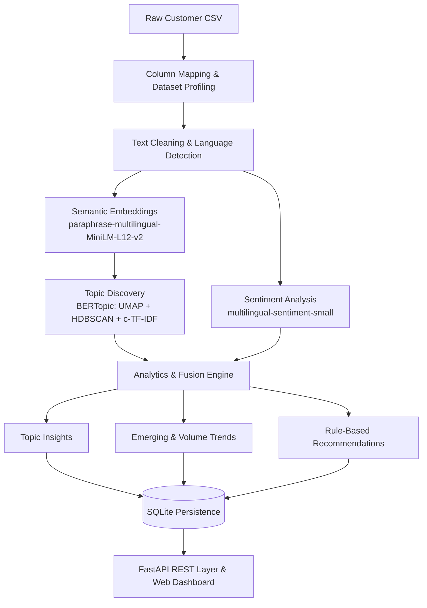

<div align="center">

# 🪺 Feed Nest

**Turn unstructured customer feedback into actionable business intelligence.**

[](https://www.python.org/)
[](https://fastapi.tiangolo.com/)
[](https://huggingface.co/)
[](https://maartengr.github.io/BERTopic/)
[](https://www.sqlite.org/)
[](#development-status)

[Overview](#overview) •
[Key Features](#key-features) •
[Architecture](#system-architecture) •
[Quickstart](#quickstart) •
[API Reference](#api-reference) •
[Roadmap](#roadmap)

</div>

---

## Overview

**Feed Nest** is an AI-powered customer feedback intelligence platform that transforms raw, scattered customer reviews, survey responses, and support logs into structured, decision-ready insights. Instead of manually reading thousands of rows of text, businesses can upload CSV datasets and automatically uncover recurring themes, track sentiment shifts, and prioritize critical pain points.

The platform is built around three core pillars:

1. **Discover** — Automatically cluster semantically similar reviews into distinct topics using neural embeddings and density-based clustering—no predefined taxonomy required.
2. **Understand** — Measure multilingual customer sentiment alongside topic distributions to pinpoint where dissatisfaction is concentrated.
3. **Act** — Surface emerging issues, longitudinal volume trends, and threshold-driven recommendations to guide product and operations teams.

### Why Feed Nest?

| The Challenge | The Feed Nest Solution |
| :--- | :--- |
| Manually tagging thousands of reviews is slow and biased | **Unsupervised BERTopic discovery** groups feedback by semantic meaning |
| Rigid keyword rules miss paraphrased complaints | **Multilingual Sentence Transformers** capture intent across phrasing variations |
| High-volume topics mask high-severity pain points | **Topic-level sentiment fusion** isolates topics with high negative concentration |
| Static snapshots hide newly emerging product bugs | **Jaccard similarity & time-series tracking** detect emerging and trending topics |
| Rigid CSV schemas break ingestion pipelines | **Flexible column mapping & dataset profiling** validate data before execution |

---

## Key Features

### 📥 Ingestion & Profiling
* **Flexible CSV Import:** Map arbitrary CSV headers (e.g., `Customer Comment`, `Star Rating`) directly to Feed Nest's canonical schema.
* **Pre-Flight Dataset Profiling:** Inspect record counts, missing values, language distribution, rating statistics, date coverage, and data quality warnings before triggering heavy ML workloads.
* **Non-Destructive Preprocessing:** Normalizes whitespace, strips empty or duplicate entries, and generates cleaned text representations while preserving raw customer quotes.

### 🧠 NLP & Topic Intelligence
* **Unsupervised Topic Discovery:** Powered by **BERTopic** (Sentence Embeddings + UMAP + HDBSCAN + c-TF-IDF) to surface themes like *Delivery Delays*, *Payment Failures*, or *App Crashes* without manual labeling.
* **Multilingual Sentiment Scoring:** Evaluates each record using `Horizon-Labs/multilingual-sentiment-small`, returning predicted polarity labels and confidence scores.
* **Emerging Topic Detection:** Compares topic keyword representations across analysis runs using **Jaccard similarity** to flag newly appearing or shifting issues.

### 📊 Analytics & Persistence
* **Topic-Sentiment Fusion:** Calculates negative review counts, negative percentages per topic, and overall sentiment breakdowns.
* **Longitudinal Volume Trends:** Tracks monthly topic volume shifts whenever timestamp metadata is available.
* **Rule-Based Recommendations:** Flags high-risk topics exceeding configurable negative-sentiment thresholds and assigns investigation priorities.
* **SQLite Analysis History:** Persists completed runs locally so teams can query and compare historical analyses via REST endpoints.

---

## System Architecture

### Processing Pipeline



### Repository Structure

```FeedNest/
├── app/                        # Web layer, REST API, and persistence
│   ├── main.py                 # FastAPI entrypoint and route definitions
│   ├── database.py             # SQLite connection and analysis history storage
│   └── static/                 # Vanilla HTML/CSS/JS frontend dashboard
│       ├── index.html
│       ├── css/styles.css
│       └── js/app.js
├── src/                        # Core ML, NLP, and analytics engine
│   ├── ingestion/              # csv_loader.py, column_mapper.py, dataset_profiler.py
│   ├── preprocessing/          # cleaner.py, language_detector.py
│   ├── discovery/              # embeddings.py, topic_model.py, topic_naming.py
│   ├── sentiment/              # sentiment_analyzer.py
│   ├── analytics/              # feedback_insights.py, topic_trends.py,
│   │                           # topic_volume_trends.py, recommendations.py
│   └── pipeline/               # analysis_pipeline.py (end-to-end orchestrator)
├── data/                       # Local input datasets
├── models/                     # Cached model artifacts
├── notebooks/                  # Experimental R&D notebooks
├── outputs/                    # Generated pipeline outputs
├── reports/                    # Exported summaries and evaluations
├── tests/                      # Unit and integration tests
├── requirements.txt
└── README.md
```
### Module Responsibilities

| Module | Responsibility |
|---|---|
| `ingestion` | CSV loading, column mapping, and dataset profiling |
| `preprocessing` | Text cleaning and language detection |
| `discovery` | Embedding generation and automatic topic discovery |
| `sentiment` | Sentiment prediction and confidence scoring |
| `analytics` | Feedback insights, topic trends, and recommendations |
| `pipeline` | Coordinates the complete feedback analysis workflow |
| `app` | FastAPI backend, database operations, and frontend serving |

---

## Installation

### Prerequisites

Before installing Feed Nest, ensure that you have:

- Python 3.10 or newer (compatible with the installed dependencies).
- pip package manager.
- Git (optional).
- A modern web browser.

### 1. Clone the Repository

```bash
git clone https://github.com/YOUR_USERNAME/FeedNest.git
```

Navigate into the project directory:

```bash
cd FeedNest
```

### 2. Create a Virtual Environment

For Windows PowerShell:

```powershell
python -m venv .venv
```

Activate the environment:

```powershell
.\.venv\Scripts\Activate.ps1
```

Alternatively, use Command Prompt:

```cmd
.venv\Scripts\activate.bat
```

### 3. Install Dependencies

```bash
python -m pip install -r requirements.txt
```

The first execution of the NLP pipeline may download the required Hugging Face model weights.

An internet connection and sufficient disk space are recommended for initial setup.

---

## Running the Application

From the project root directory, execute:

```bash
python -m uvicorn app.main:app --host 127.0.0.1 --port 8000
```

Once the server starts, access the following URLs:

| Resource | URL |
|---|---|
| Feed Nest Frontend | http://127.0.0.1:8000/ |
| API Documentation | http://127.0.0.1:8000/docs |
| Alternative API Documentation | http://127.0.0.1:8000/redoc |

To stop the server, press:

```text
CTRL + C
```

For development environments, automatic reloading can be enabled:

```bash
python -m uvicorn app.main:app --reload
```

---

## Using Feed Nest

The intended workflow consists of the following steps:

1. Open the Feed Nest web application.
2. Upload a customer feedback CSV file.
3. Map the dataset columns to the corresponding Feed Nest fields.
4. Start the feedback analysis process.
5. Allow the backend to process the dataset.
6. Review discovered topics and sentiment predictions.
7. Explore feedback insights, topic trends, and recommendations.
8. Access previous analyses through the analysis history.

The availability of individual dashboard interactions depends on the current frontend implementation.

---

## Dataset Format

Feed Nest requires a `review_text` column containing customer feedback.

The following fields are supported:

| Column | Requirement | Description |
|---|---|---|
| `review_text` | Required | Customer feedback text |
| `rating` | Optional | Customer rating |
| `date` | Optional | Feedback submission date |
| `product` | Optional | Associated product |
| `source` | Optional | Feedback source |

### Example Dataset

```csv
review_text,rating,date,product,source
"The product quality is excellent.",5,2026-09-01,Wireless Earbuds,Website
"Delivery was delayed and support did not respond.",1,2026-09-02,Travel Backpack,Mobile App
"The application is easy to use.",4,2026-09-03,Mobile App,Website
"The refund process took too long.",2,2026-09-04,Subscription Plan,Email
```

### Flexible Column Mapping

Feed Nest supports mapping custom CSV headers to its standard fields.

For example:

| Original CSV Column | Feed Nest Field |
|---|---|
| Customer Comment | `review_text` |
| Star Rating | `rating` |
| Submission Date | `date` |
| Item Name | `product` |
| Feedback Channel | `source` |

This allows datasets from different sources to be processed without requiring identical column names.

---

## API Reference

Feed Nest uses FastAPI to expose backend functionality through REST API endpoints.

The main endpoints include:

| Method | Endpoint | Description |
|---|---|---|
| GET | `/` | Serves the frontend |
| POST | `/analyze` | Uploads and analyzes customer feedback |
| GET | `/analyses` | Retrieves analysis history |
| GET | `/analyses/{analysis_id}` | Retrieves a specific analysis |

### Interactive API Documentation

FastAPI automatically generates interactive API documentation.

Access it at:

```text
http://127.0.0.1:8000/docs
```

The documentation allows developers to inspect available endpoints, request parameters, and response structures.

---

## Machine Learning and NLP

Feed Nest combines multiple Natural Language Processing techniques to analyze customer feedback.

### 1. Semantic Embeddings

Sentence Transformers convert customer feedback into numerical vector representations.

These embeddings capture semantic meaning, allowing similar feedback records to be grouped even when they use different words or expressions.

**Model:**

`sentence-transformers/paraphrase-multilingual-MiniLM-L12-v2`

### 2. Topic Modeling

BERTopic discovers recurring themes within customer feedback.

It combines:

- Sentence Transformer embeddings for semantic representation.
- UMAP for dimensionality reduction.
- HDBSCAN for density-based clustering.
- Class-based TF-IDF for topic representation.

The resulting topics help identify recurring customer concerns without requiring a predefined category list.

### 3. Sentiment Classification

The sentiment analysis module uses a multilingual Hugging Face model to estimate the sentiment expressed in each feedback record.

**Model:**

`Horizon-Labs/multilingual-sentiment-small`

Predictions include sentiment labels and associated confidence scores.

### 4. Topic-Level Analytics

Topic assignments are combined with sentiment predictions to calculate useful measurements, including:

- Total feedback per topic.
- Negative feedback count.
- Negative feedback percentage.
- Topic-level performance indicators.

These measurements help identify topics associated with customer dissatisfaction.

### 5. Emerging Topic Detection

Feed Nest includes a topic comparison mechanism that uses Jaccard similarity between topic keyword representations.

This helps identify potentially new or changing topics across analysis periods.

### 6. Recommendation Generation

The recommendation module evaluates topic-level negative feedback percentages and applies configurable thresholds to identify areas requiring attention.

---

## Current Development Status

Feed Nest is under active development.

The following table describes the current implementation status:

| Component | Status |
|---|---|
| CSV ingestion | Implemented |
| Column mapping | Implemented |
| Dataset profiling | Implemented |
| Text preprocessing | Implemented |
| Language detection | Implemented |
| Semantic embeddings | Implemented |
| BERTopic discovery | Implemented |
| Topic naming | Initial implementation |
| Sentiment analysis | Implemented |
| Feedback insights | Implemented |
| Emerging topic detection | Initial implementation |
| Topic volume trends | Implemented |
| Rule-based recommendations | Implemented |
| FastAPI backend | Initial integration |
| SQLite persistence | Implemented |
| Frontend integration | In progress |
| End-to-end validation | Pending |

*Implementation status refers to the existence of the corresponding modules and does not imply that every component has passed complete end-to-end testing.*

---

## Limitations

Several limitations should be considered when interpreting Feed Nest's results:

- Topic discovery quality depends on dataset size, language consistency, and feedback diversity.
- Small datasets may not produce meaningful topic clusters.
- HDBSCAN may classify some feedback as noise rather than assigning it to a topic.
- Sentiment predictions are estimates and may not always capture sarcasm, context, or customer intent.
- Roman Urdu and informal multilingual writing may not always be detected or interpreted reliably.
- Rule-based recommendations depend on configured thresholds.
- Topic trend comparisons depend on the availability and consistency of historical topic information.
- Processing large datasets on CPU may require considerable time.
- Synthetic datasets are useful for development but cannot establish real-world model performance.

---

## Future Improvements

The long-term development direction of Feed Nest includes several areas of improvement.

### Advanced Topic Management

- Human-approved topic names.
- Topic merging and splitting.
- Topic renaming.
- Topic exclusion.
- Improved topic stability across analysis sessions.

### Improved Intelligence

- Better multilingual and Roman Urdu support.
- More robust sentiment classification.
- Aspect-based sentiment analysis.
- Improved topic naming.
- Better detection of emerging customer issues.

### Historical Intelligence

- Persistent topic snapshots.
- More reliable cross-period topic matching.
- Historical sentiment comparisons.
- Long-term customer feedback trends.

### Business Intelligence

- Interactive analytics dashboards.
- Exportable analytical reports.
- Product-level comparisons.
- Feedback source comparisons.
- Custom reporting periods.
- Context-aware recommendations.

### Production Readiness

- User authentication.
- Multi-user workspaces.
- Database scalability.
- Secure file handling.
- Background processing for large datasets.
- Automated testing.
- Deployment and monitoring.

---

## Contributing

Contributions, suggestions, and improvements are welcome.

To contribute:

1. Fork the repository.
2. Create a feature branch.
3. Implement your changes.
4. Test the affected functionality.
5. Submit a pull request with a clear description.

For significant changes, consider opening an issue first to discuss the proposed implementation.

---

## License

The licensing terms for Feed Nest have not yet been specified.

A license should be added to the repository before public distribution. Third-party libraries and machine learning models may also have their own licensing requirements.

---

## Project Philosophy

Feed Nest is built around a simple idea:

**Customer feedback should be more than a collection of comments. It should be a source of meaningful business intelligence.**

By combining semantic understanding, automatic topic discovery, sentiment analysis, and structured analytics, Feed Nest aims to help businesses move from simply collecting feedback to genuinely understanding it.

---

**Feed Nest — Turn feedback into understanding.**